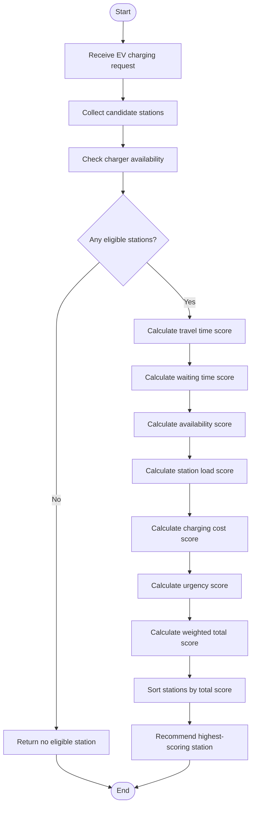

# EV-OPT Recommendation Flowchart

## Recommendation Process

## Explanation

1. The engine receives an EV charging request.
2. Candidate charging stations are collected.
3. Stations without available chargers are excluded.
4. The engine calculates scores using six recommendation factors.
5. A weighted total score is calculated for each eligible station.
6. Stations are sorted from highest score to lowest score.
7. The highest-scoring station is recommended.

## Important Note

The current scoring formulas use simplified assumptions.
Real-world integration requires suitable travel-time,
waiting-time, charging-cost, and station-load data.
